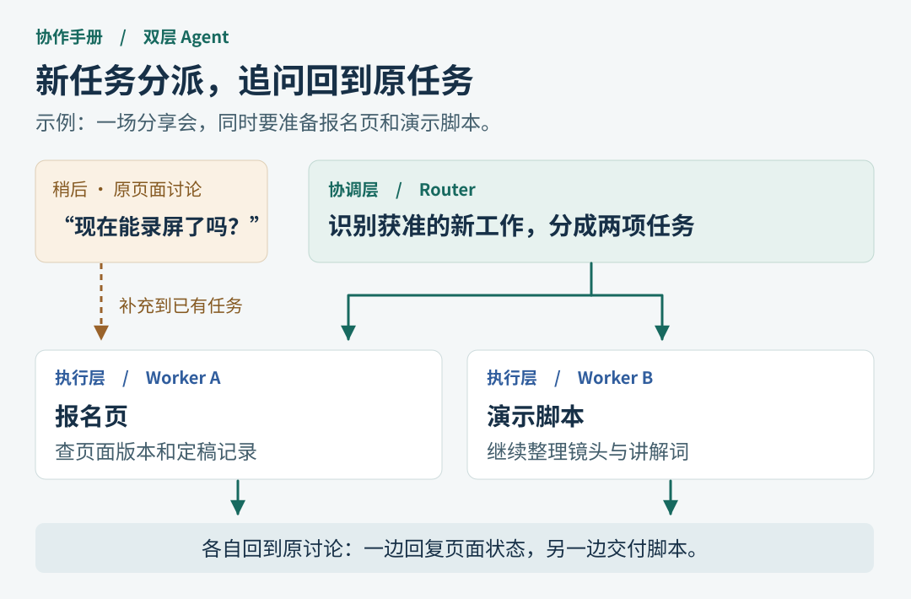
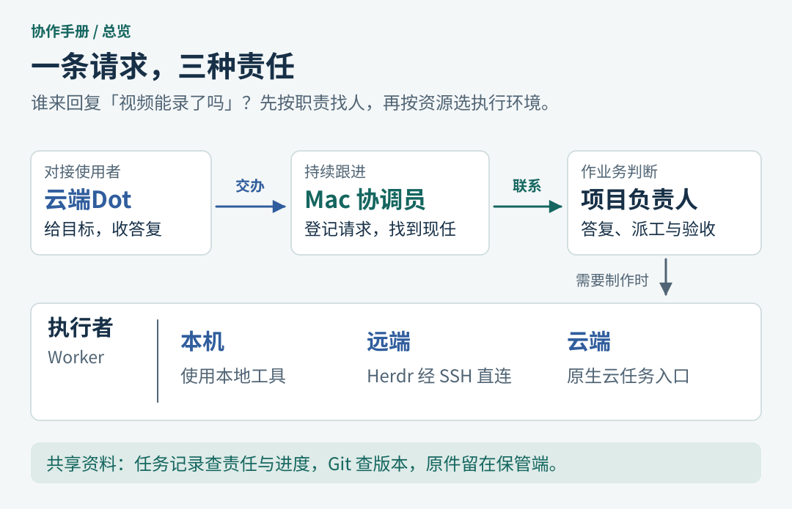
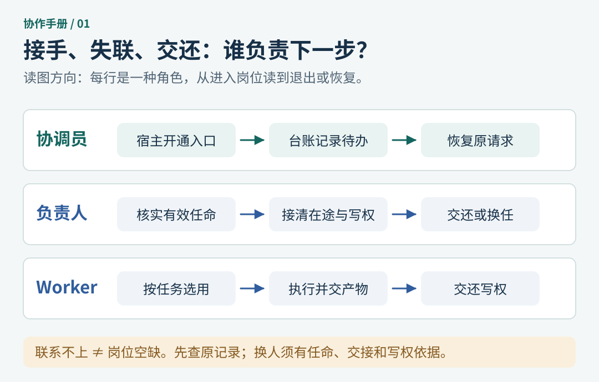
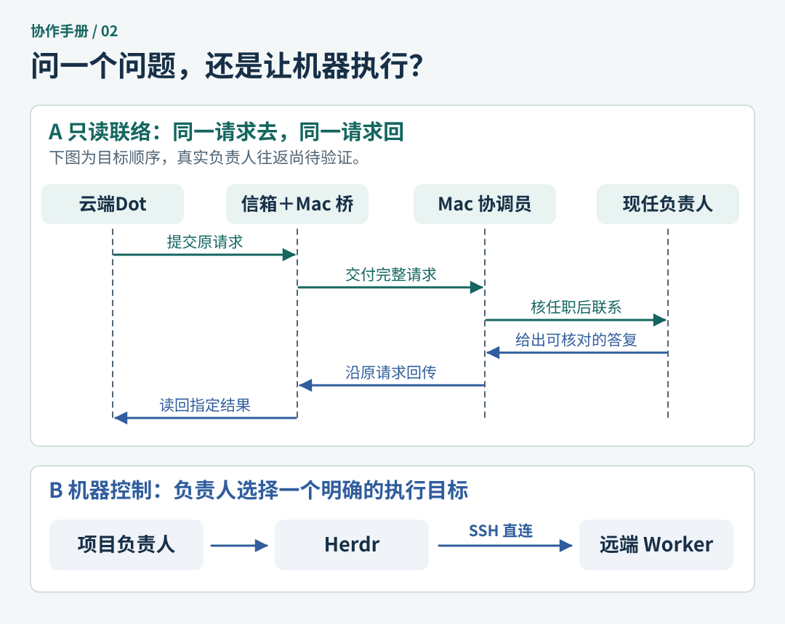
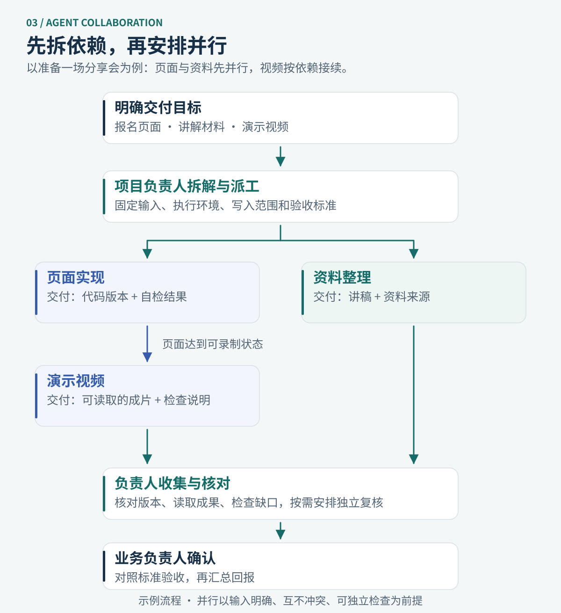
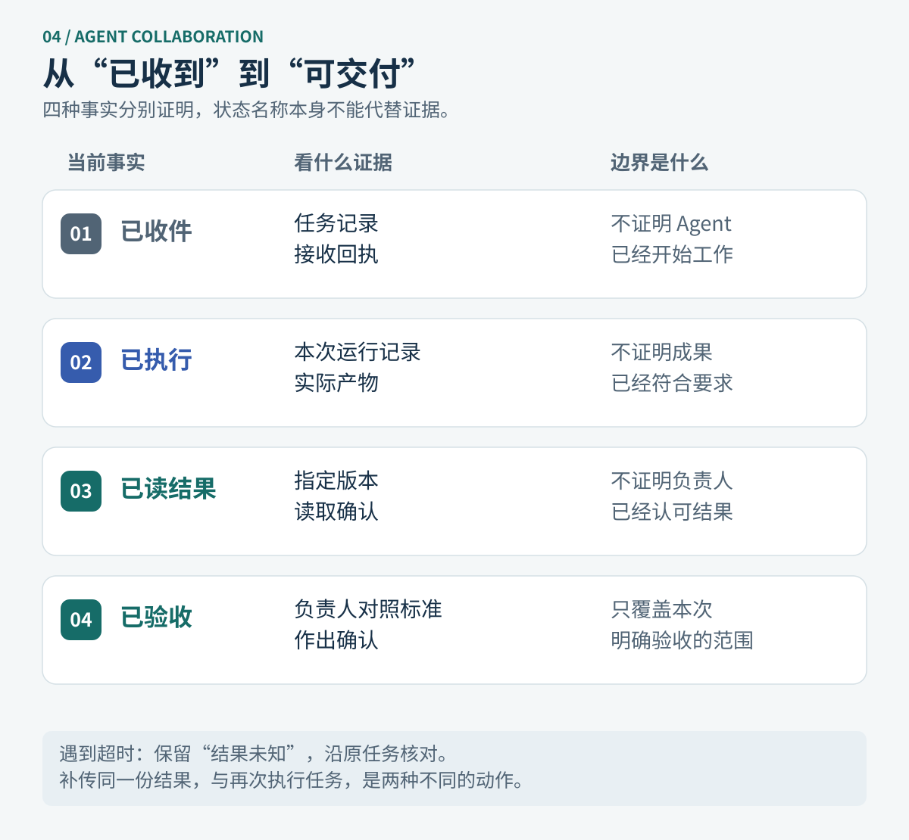

“报名页已经能打开了，演示视频现在可以录吗？”这是个进度问题。最了解页面是否定稿的人是项目负责人；如果 AI 收到问题就重新生成页面，反而多做了一份没人要的工作。

所以，我给多 Agent 团队加了一项分工：**云端Dot 接需求，Mac 协调员找人并跟进，项目负责人作判断，需要动手时才交给 Worker（执行者）。**

<!-- more -->

## Super-agent：一个助手，怎样同时跟进几件事？

在 DeepSeek 的 [Super-agent 设计](https://zhuanlan.zhihu.com/p/2099987320443237060)里，用户可以一直找同一个助手办事。背后有两层分工：**Router（协调层）**判断该不该接新任务、该派给谁；**Worker（执行层）**各自在自己的会话里做一件事。一个 Worker 忙着写脚本，另一个仍能回答报名页的问题。[公开研究原型与执行设计](https://github.com/deepseek-ai/dsh-superagent-prototype/blob/main/docs/003-execution.md)

关键在第二句话。最初说“准备报名页和脚本”，需要分工；后来在页面讨论里问“现在能录屏了吗？”，就让原任务查定稿记录。追问能带来新信息，但不会自动授予录制或发布权限。[原型中的任务与订阅](https://github.com/deepseek-ai/dsh-superagent-prototype/blob/main/docs/001-domain.md)

## 一张图看懂谁做决定

在我们的项目里，“双层”说的是职责，不要求恰好运行两个模型。云端Dot 选择项目，项目负责人决定怎么做；Mac 协调员记下请求，找到现任负责人，再把答复带回来。Herdr 和 SSH 提供执行通道。

## 协调员怎么找到对的人？

| 收到什么 | 谁来处理 |
| --- | --- |
| “报名页定稿了吗？” | 协调员查正式任命，把问题交给现任负责人。 |
| “汇总几个项目的阻塞” | 设计上可明确委托协调员汇总；首版只支持查询已登记项目的阻塞。 |
| “这个也顺便改一下” | 先问清改谁的资产、谁有写权，再分派。 |

比如旧负责人刚交还工作，即使还能打开旧会话，也不能据此把新请求发过去。先核现任和接手记录；尚未核实时，留下原请求继续查。定时观察器（Watchdog）只负责记下哪些等待已到期。

## 问进度和让机器干活，走两条路

问进度要能核实**谁在答，以及云端Dot 读到的是哪次答复**。同一账号下填个“负责人”的名字不够。让机器执行才需要指定目标：我已弃用 Lody，远端采用 **Herdr 经 SSH 直连**；现有显式执行接入器的试点范围仅限 Mac 本地已有 Agent。

## 分享会演练：什么时候开始录视频？

假设负责人回报：“议程还没定，先准备录制脚本。”云端Dot 读到这句话，**联络成功**。议程确认、页面达到可录制状态，才算**解除阻塞**。成片能打开、内容符合要求并由负责人确认，才算**完成交付**。这是讲解示例。

会话事件（hook）可以提示何时去查。比如中断也可能让会话显示空闲；它不能证明文件已经生成。没有收到回执时，先查原任务和产物，再决定下一步。

## 哪些已经跑过？

| 环节 | 截至 2026-11-03 的证据 | 仍待验证 |
| --- | --- | --- |
| Mac 协调员 | 本地台账已部署；观察器连续两次按时运行，间隔一分钟 | 长期运行及整机重启后的恢复 |
| 任务信箱与 Mac 桥 | 已有任务验证了收件、补传和指定版本的读取确认 | 新的负责人查询沿原请求往返 |
| Worker 执行 | Mac 已有 Agent 完成一次合成任务，产物和回传已核；远端 Herdr／SSH 已做只读查询 | 远端 Agent 的实际业务交付 |
| Codex Cloud | 直接绑定现有项目仓库，环境已发布、可启动，无需另建环境仓 | 云端 Worker 的工具权限、运行和交付 |
| 桥与协调员联调 | 隔离环境已收件并传回模拟答复；模拟回执丢失后，补传仍只有一个结果版本 | 核实双方身份，由现任负责人答复，云端Dot 读回同一请求的结果 |

这张表引用项目维护与部署记录。一次 Mac 合成任务走通，不等于最后一行也通过。

**20 分钟分享顺序：** 4 分钟讲双层分工与项目角色 → 4 分钟对照两条路径 → 7 分钟用录屏案例区分联络、解阻和交付 → 5 分钟看验证表，讨论“还差哪份证据”。

*资料说明：知乎原文直读受限，设计细节以作者公开原型核对。云环境用法见 [OpenAI 官方文档](https://learn.chatgpt.com/docs/environments/cloud-environments)。*
